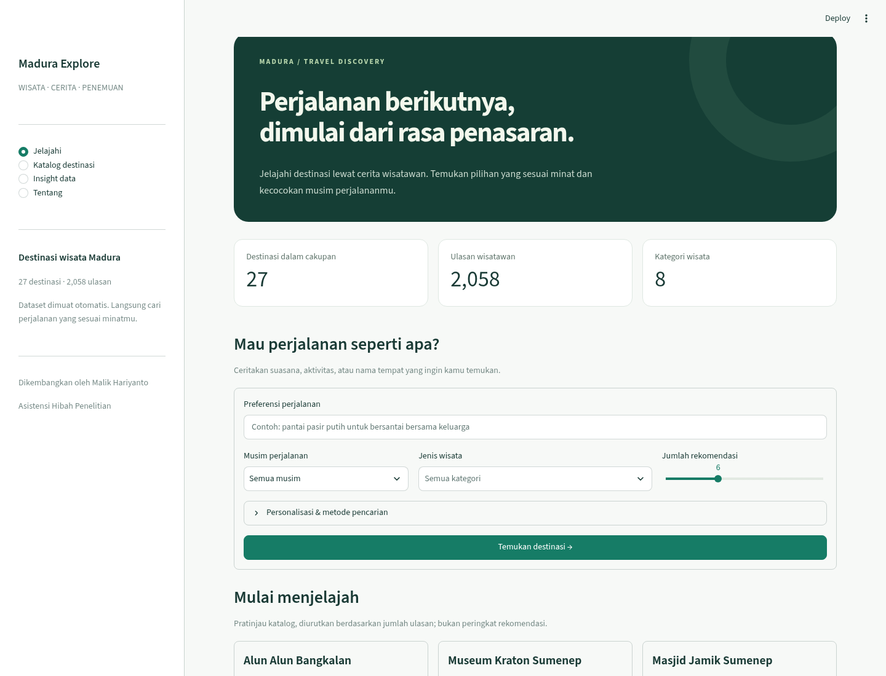
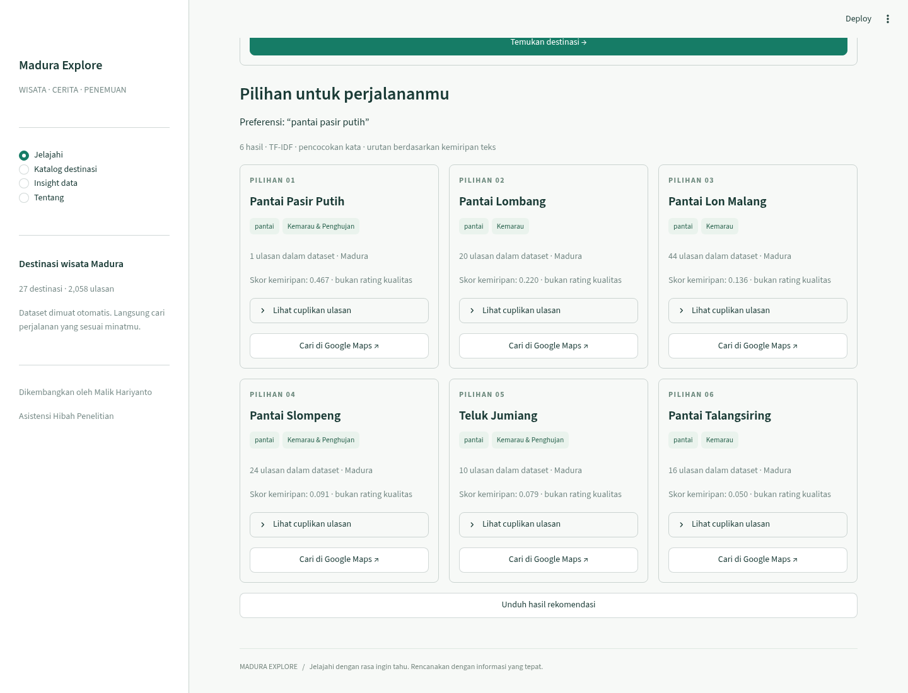

# Madura Explore — deployment dan struktur

Aplikasi memuat otomatis dataset terbaru `dataset_madura_bersih.xlsx`: **2.058 ulasan, 27 destinasi, 8 kategori wisata Madura**. Seluruh dataset dinyatakan berada di Madura oleh pemilik data. Pengguna aplikasi tidak perlu mengunggah file, CSV wilayah, atau melakukan verifikasi lokasi.

## Streamlit Community Cloud

| Field | Nilai |
|---|---|
| Repository | `MalikHariyanto/crispy_recom_machine_system` |
| Branch | `feat/streamlit-wisata` |
| Main file path | `app.py` |
| Python (Advanced settings) | `3.11` |

Streamlit memasang `requirements.txt` dari root. Default TF-IDF tidak memerlukan secrets, API key, atau unduhan model. Setelah pembaruan kode, pilih **Manage app → Reboot app** bila tampilan masih versi lama.

## Lokal

```bash
python -m venv .venv
source .venv/bin/activate
pip install -r requirements.txt
streamlit run app.py
```

Pada Windows: `.venv\Scripts\activate`. Sertakan `src/`, `.streamlit/`, dan seluruh `data/` saat memindahkan aplikasi.

## Struktur dan performa

- `app.py`: entry point deployment.
- `src/wisata_madura/web/app.py`: navigasi empat halaman; dataset dimuat otomatis.
- `views.py` / `styles.py`: komponen, pencarian, katalog, insight, identitas visual lokal.
- `services.py`: indeks TF-IDF dan filter musim/kategori/nama.
- `runtime.py`: cache data dan indeks dengan hash manifest; hasil pencarian sesi dikaitkan versi dataset.
- `src/wisata_madura/visualization.py`: grafik EDA dan split untuk notebook Colab.

Katalog serta audit memakai `st.cache_data`; indeks memakai `st.cache_resource`. Setiap query hanya ditransformasi terhadap indeks. Pagination menampilkan sembilan kartu per halaman. Tidak ada pelatihan model saat membuka halaman. Workbook sumber disimpan di `data/source/`; default web hanya membutuhkan CSV model terkompresi dan manifest ber-checksum.

## Rekomendasi

TF-IDF unigram/bigram dengan sublinear TF, maksimum 30.000 fitur, dan kemiripan kosinus. Deskripsi terdiri dari nama, jenis, label cuaca, dan maksimal 12 cuplikan ulasan. Musim, kategori, serta riwayat kunjungan membatasi kandidat; skor nol tidak ditampilkan. Skor bukan rating kualitas atau probabilitas. Label cuaca merupakan atribut dataset, bukan prakiraan cuaca langsung. Cuplikan adalah teks setelah preprocessing, bukan keterangan redaksi atau verifikasi fasilitas.

## BGE opsional

Pasang `sentence-transformers>=3,<6`, lalu restart server untuk memunculkan opsi BGE-M3. Model baru dimuat saat dipilih dan digunakan. Membutuhkan akses Hugging Face, penyimpanan dan RAM lebih besar daripada default. Mode deploy ringan yang diuji adalah TF-IDF; BGE belum diuji dengan unduhan model. Pelatihan LDA/FastText/BiLSTM tetap berada pada notebook.

## Colab dan grafik

[Buka notebook lengkap di Colab](https://colab.research.google.com/github/MalikHariyanto/crispy_recom_machine_system/blob/feat/streamlit-wisata/notebooks/Colab_Audit_Wisata_Madura_Otomatis.ipynb). Jalankan sel dari atas, `DATA_PATH=None`. Dataset dan rating dimuat otomatis dari repo, tanpa unggahan.

Bagian 02B memuat diagram batang rating, batang label cuaca per ulasan, donut cuaca per destinasi, pie jenis wisata per destinasi, dan histogram panjang ulasan. Bagian 03 sudah memiliki train/validation/test; kini dilengkapi batang jumlah dan donut persentase aktual untuk ulasan serta destinasi. Rating/cuaca berupa kategori diskret, sehingga menggunakan diagram batang; histogram dipakai untuk panjang teks numerik. Gambar PNG dan tabel CSV disimpan ke folder run.

Split per ID destinasi mencegah tempat yang sama muncul di partisi berbeda. Target test sekitar 20% destinasi dan validation sekitar 20% dari sisa train, bukan jaminan rasio ulasan tepat 64:16:20. Duplikat, teks kosong, dan teks identik lintas partisi dibersihkan. Proporsi dihitung ulang dari hasil split aktual.

## Pengujian

```bash
PYTHONPATH=src python -m unittest discover -s tests -p 'test_web_services.py' -v
PYTHONPATH=src python -m unittest discover -s tests -p 'test_streamlit_app.py' -v
# Tes workbook/grafik: pasang requirements-wisata.txt terlebih dahulu.
PYTHONPATH=src python -m unittest discover -s tests -p 'test_dataset_update.py' -v
PYTHONPATH=src python -m unittest discover -s tests -p 'test_visualization.py' -v
```

Tes mencakup pemeringkatan, filter, navigasi, ketiadaan unggahan file, kesetaraan Excel–bundle, jumlah rating, unit hitung pie chart, dan persentase aktual split. Pelatihan BiLSTM memerlukan PyTorch dan tidak menjadi dependensi web default. Laporan/model eksperimen lama tetap artefak historis; penambahan grafik tidak menghitung ulang evaluasi seluruh model.

## Pratinjau



