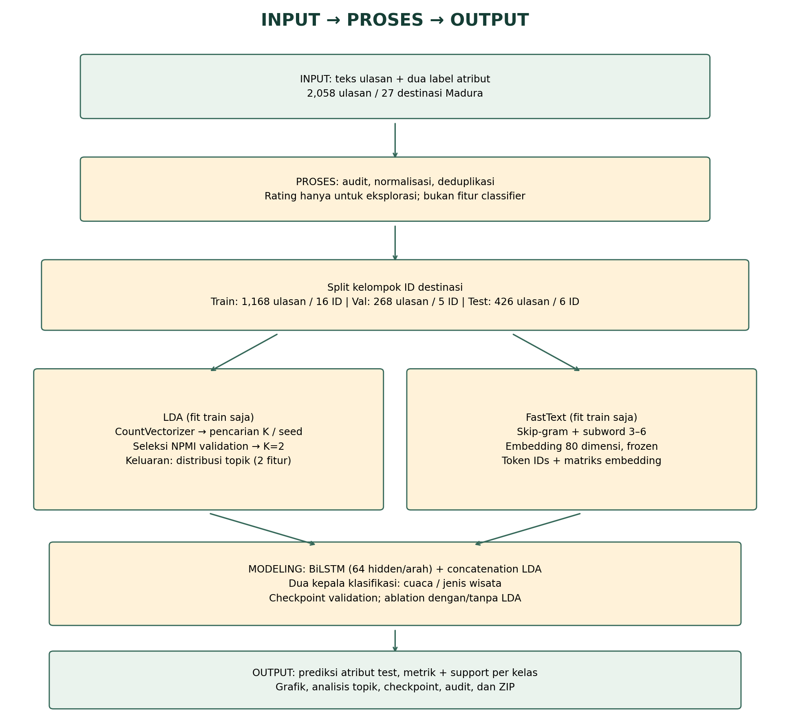

# Validasi pipeline Colab v3

Ringkasan eksekusi `MODE="full"` pada CPU dengan dataset terbaru: 2.058 ulasan / 27 destinasi. Seluruh sel komputasi notebook dieksekusi berurutan pada lingkungan lokal dengan dependensi deklaratif yang sudah terpasang; hanya pemanggilan pip dilewati oleh harness validasi. Ini bukan klaim telah menjalankan sesi Colab GPU jarak jauh.

- Grid LDA lengkap: 6 jumlah topik × 3 seed, maksimal20 iterasi.
- FastText + dua ablation BiLSTM: seed42/43/44, maksimal15 epoch dengan early stopping.
- Pembanding klasik fit sekali; jumlah run tercantum pada tabel metrik.
- Seluruh 17 tes lulus, termasuk checkpoint PyTorch, split, metrics support, dan UI.
- Metadata audit menyimpan commit dasar, kondisi working tree, dan hash setiap modul yang dieksekusi. Validasi ini dijalankan sebelum commit perubahan, sehingga hash modul adalah pengenal kode yang tepat.

## Split aktual setelah pembersihan

| Partisi | Ulasan | Destinasi | Persen ulasan |
|---|---:|---:|---:|
| Train | 1.168 | 16 | 62,73% |
| Validation | 268 | 5 | 14,39% |
| Test | 426 | 6 | 22,88% |

Kandidat split dipilih menggunakan ukuran/label kelompok sebelum fit, bukan skor model. `audit_split.json` mencatat kandidat, objektif, dan baris dibuang. `cakupan_kelas_partisi.csv` menunjukkan kelas yang hanya ada di train.

## Hasil dibaca tanpa klaim peningkatan

K terpilih=2 pada run ini, dengan rerata validation NPMI sekitar **−0,5502**. Terpilih dalam grid tidak berarti semantik topik sudah baik. Contoh dan review manusia tetap diperlukan.

Pada enam destinasi test, model deep tidak menunjukkan keunggulan yang konsisten atas pembanding. Khusus target jenis wisata, hasil deep sangat rendah; hasil itu tetap dicantumkan. Tidak ada tuning ulang berdasarkan skor test, pemilihan seed terbaik, atau penghapusan kelas sulit. Macro-F1 utama menyertakan seluruh kelas; `macro_f1_present` hanya kelas yang hadir. Lihat support sebelum menilai kualitas.

Variasi tiga seed hanya mengukur variasi run pada satu split, bukan confidence interval atau bukti generalisasi antardataset. Kelas train-only dan jumlah destinasi kecil membatasi kesimpulan. Kualitas label/preprocessing sumber tetap perlu penelaahan.

## Berkas

- `alur_pipeline.png`, `alur_input_proses_output.csv`: diagram dan kontrak antarsection.
- `ringkasan_pembagian_data.csv`, `cakupan_kelas_partisi.csv`, `audit_split.json`: split aktual.
- `pemilihan_topik.csv`, `audit_lda.json`, kata/contoh/review: LDA dan batas interpretasi.
- `metrik_klasifikasi.csv`, `metrik_per_kelas.csv`, `ringkasan_metrik_seed.csv`: seluruh skor, bukan hasil terbaik saja.
- `models/seed_*/checkpoint_bilstm.csv`, loss/PNG: bukti epoch terbaik dipakai.
- `audit_dataset.json`, `validation.json`: parameter, versi paket, hash/protokol validasi.

Model FastText/checkpoint biner tidak dimasukkan ke GitHub agar repo tetap ringan. Run Colab tetap menyimpan model lengkap dalam folder run dan ZIP yang dapat diunduh.

